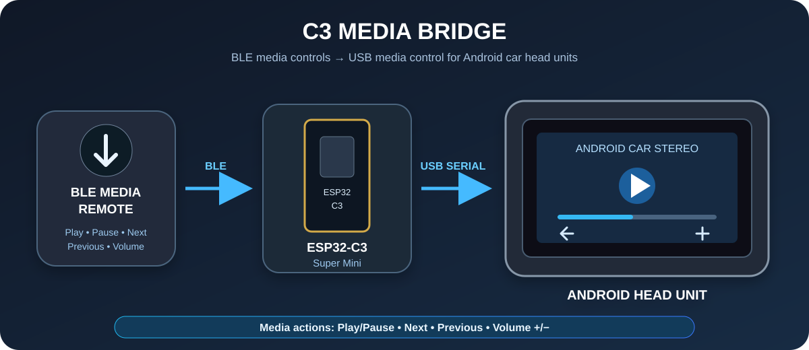

# C3 Media Bridge

<p align="center">
  <strong>Use a BLE media remote to control an Android car head unit through an ESP32-C3 and USB.</strong>
</p>

<p align="center">
  
  
  
  
  <a href="https://github.com/Ahmed-eskafi/c3-media-bridge/actions/workflows/build-apk.yml"></a>
</p>

C3 Media Bridge is an Android companion application for an **ESP32-C3 Super Mini** media-control bridge. A BLE media remote sends control commands to the ESP32-C3. The board forwards those commands to an Android device over USB serial, where the app translates them into media and volume actions. The intended Android device is an **Android car stereo / head unit**, not a phone.

## System diagram

<p align="center">
  
</p>

**Signal path:** BLE media remote → ESP32-C3 Super Mini → USB Serial → Android car head unit.

## Project photos

These reference photos show the real-world components and installation style used by this project. Images are hosted by their original publishers; availability depends on those sites allowing external image embedding.

### Android car head unit

<p align="center">
  
</p>
<sub>Project reference image: Android multimedia head unit supplied for this project.</sub>

### ESP32-C3 Super Mini board

<p align="center">
  <a href="https://zaitronics.com.au/products/esp32-c3-supermini-wi-fi-bluetooth-development-board">
    
  </a>
</p>
<sub>Product photo: Zaitronics ESP32-C3 SuperMini listing.</sub>

### BLE media remote

<p align="center">
  <a href="https://www.ebay.com/itm/364579185761">
    
  </a>
</p>
<sub>Product photo: eBay listing for a Bluetooth steering-wheel media remote.</sub>

For image source links and usage notes, see [Image Credits](docs/IMAGE_CREDITS.md).

## Features

- USB serial communication with the ESP32-C3 (USB VID `0x303A`, PID `0x1001`).
- Music volume up and down.
- Play/pause, next track, and previous track controls.
- Background foreground-service to keep the bridge available while the app UI is closed.
- USB connection monitoring and reconnect handling.
- Optional media-session access for controlling the active media session.
- Test buttons for volume up and play/pause.
- GitHub Actions workflow to build a debug APK.

## Supported serial commands

Send one command per line, terminated with a newline:

| Command | Android action |
| --- | --- |
| `VOL_UP` | Increase music volume |
| `VOL_DOWN` | Decrease music volume |
| `PLAY_PAUSE` | Toggle playback |
| `NEXT` | Skip to next track |
| `PREVIOUS` | Go to previous track |

Serial settings: **115200 baud, 8 data bits, no parity, 1 stop bit (8N1)**.

## Android car head unit setup

1. Build and install the debug APK on an Android car head unit that supports USB host mode and USB accessories.
2. Connect the ESP32-C3 to the head unit using a suitable USB data cable or adapter.
3. Open the app and grant notification permission if Android requests it.
4. Enable **Media / Notification Access** in Android settings when active media-session control is required.
5. Pair the BLE media remote with the ESP32-C3 firmware.
6. Send one of the supported serial commands and test playback and volume.

Compatibility depends on the head unit's Android version, USB host implementation, permissions, and media-session behavior. Some head units may require a USB adapter or manual permission approval.

## Build

The project uses Gradle and Java. Build a debug APK locally with:

```bash
gradle :app:assembleDebug
```

Or download the latest debug APK from the [Build Android APK workflow](https://github.com/Ahmed-eskafi/c3-media-bridge/actions/workflows/build-apk.yml). Open the latest successful run, then download the **C3-Media-Bridge-APK** artifact.

## Tools and technologies

- **Android Studio** — recommended IDE for opening, editing, and building the Android project.
- **Java** — Android application source language.
- **Android SDK** — platform APIs and build tools.
- **Gradle** — project build system.
- **USB Serial for Android** — serial communication with the ESP32-C3.
- **Git and GitHub** — source control and project hosting.
- **GitHub Actions** — automated debug APK build workflow.
- **Arduino IDE** — useful for developing/flashing the separate ESP32-C3 firmware; the firmware is not included in this Android application repository.

## Project structure

```text
app/src/main/
├── AndroidManifest.xml
├── java/com/c3mediabridge/
│   ├── MainActivity.java
│   ├── UsbMediaService.java
│   ├── UsbAttachActivity.java
│   ├── BootReceiver.java
│   └── MediaNotificationListener.java
└── res/

docs/
└── c3-media-bridge-diagram.svg
```

## Project status

The Android debug APK build completed successfully in GitHub Actions on 22 November 2026. This confirms compilation and packaging only; end-to-end operation on a physical car head unit still requires hardware validation. The repository contains the Android receiver application. ESP32-C3 firmware for BLE remote pairing and serial command transmission is separate and is not included here.

See [Testing and Compatibility](docs/TESTING.md) for the manual hardware-validation checklist and [Release Checklist](docs/RELEASE_CHECKLIST.md) before publishing a production build.

## Release downloads

Check the [Releases page](https://github.com/Ahmed-eskafi/c3-media-bridge/releases) for published builds. A release APK should only be listed after a successful build and validation.

## Author

**Ahmed Eskafi** · [GitHub profile](https://github.com/Ahmed-eskafi)

---

If you find a bug or have an improvement idea, feel free to open an issue.


---

# الشرح باللغة العربية

## ما هو مشروع C3 Media Bridge؟

مشروع **C3 Media Bridge** هو تطبيق أندرويد يعمل كحلقة وصل بين ريموت وسائط يعمل بتقنية Bluetooth Low Energy (BLE) وبين شاشة السيارة التي تعمل بنظام Android. يعتمد المشروع على لوحة **ESP32-C3 Super Mini** لاستقبال أوامر الريموت لاسلكيًا، ثم إرسال هذه الأوامر إلى شاشة السيارة عن طريق كابل USB باستخدام الاتصال التسلسلي (USB Serial).

بمعنى أبسط: بدلًا من توصيل الريموت مباشرة بشاشة السيارة، يستقبل ESP32-C3 ضغطات الأزرار من الريموت، ويحوّلها إلى أوامر نصية، ثم يرسلها عبر USB إلى تطبيق C3 Media Bridge المثبّت على شاشة السيارة. يقوم التطبيق بقراءة الأوامر وتنفيذ الإجراء المناسب، مثل رفع الصوت أو خفضه أو تشغيل الموسيقى وإيقافها أو الانتقال بين المقاطع.

**ملاحظة مهمة:** التطبيق مصمم أساسًا لشاشات السيارات التي تعمل بنظام Android وتدعم USB Host، وليس للاستخدام على الهاتف كهدف أساسي. كما أن برنامج ESP32-C3 (Firmware) منفصل عن هذا المستودع، ويجب برمجته على اللوحة بشكل مستقل.

## كيف يعمل النظام؟

يتكوّن النظام من أربع مراحل رئيسية:

1. **ريموت الوسائط Bluetooth BLE:** يرسل إشارة عند الضغط على أحد الأزرار، مثل زر رفع الصوت أو الانتقال إلى المقطع التالي.
2. **لوحة ESP32-C3 Super Mini:** تستقبل إشارة Bluetooth من الريموت، وتحدد الزر الذي تم الضغط عليه، ثم تحوّل الضغط إلى أمر نصي مناسب.
3. **اتصال USB Serial:** ترسل اللوحة الأمر إلى شاشة السيارة من خلال كابل USB. يستخدم الاتصال سرعة 115200 baud وإعدادات 8N1.
4. **تطبيق C3 Media Bridge:** يستقبل التطبيق الأمر من منفذ USB، ويتعرف على نوعه، ثم ينفذ وظيفة الوسائط أو التحكم بالصوت على نظام Android.

### مخطط انتقال الأوامر

ريموت BLE ← اتصال Bluetooth ← ESP32-C3 ← كابل USB ← تطبيق Android ← التحكم بالصوت والموسيقى.

## مكونات المشروع

- **ESP32-C3 Super Mini:** لوحة التطوير المسؤولة عن استقبال أوامر الريموت وإرسالها إلى شاشة السيارة.
- **ريموت وسائط BLE:** جهاز التحكم الذي يحتوي على أزرار الوسائط، مثل التشغيل والإيقاف ورفع وخفض الصوت والتنقل بين المقاطع.
- **كابل USB يدعم نقل البيانات:** يستخدم لربط لوحة ESP32-C3 بشاشة السيارة. يجب ألا يكون الكابل مخصصًا للشحن فقط.
- **شاشة سيارة تعمل بنظام Android:** الجهاز الذي يتم تثبيت التطبيق عليه، ويجب أن يدعم توصيل أجهزة USB بوضع USB Host.
- **تطبيق C3 Media Bridge:** تطبيق Android الذي يستقبل الأوامر وينفذها.

## الوظائف والأزرار المدعومة

يستقبل التطبيق الأوامر التالية من لوحة ESP32-C3:

| الأمر المرسل | الوظيفة على شاشة السيارة |
| --- | --- |
| `VOL_UP` | رفع مستوى صوت الوسائط |
| `VOL_DOWN` | خفض مستوى صوت الوسائط |
| `PLAY_PAUSE` | تشغيل الموسيقى أو إيقافها مؤقتًا |
| `NEXT` | الانتقال إلى المقطع التالي |
| `PREVIOUS` | الرجوع إلى المقطع السابق |

يجب إرسال كل أمر في سطر مستقل، مع إضافة سطر جديد في نهايته (Newline)، حتى يتمكن التطبيق من قراءته بصورة صحيحة.

## طريقة التوصيل والتشغيل

1. جهّز لوحة ESP32-C3 Super Mini والريموت الذي يعمل بتقنية BLE.
2. تأكد من أن برنامج ESP32-C3 يدعم الاقتران بالريموت والتعرف على أزراره.
3. ثبّت تطبيق C3 Media Bridge على شاشة السيارة التي تعمل بنظام Android.
4. صِل لوحة ESP32-C3 بمنفذ USB في شاشة السيارة باستخدام كابل يدعم نقل البيانات.
5. افتح التطبيق ووافق على إذن الوصول إلى جهاز USB عندما تظهر نافذة طلب الإذن.
6. إذا كنت تحتاج إلى التحكم بجلسة تشغيل الوسائط النشطة، فعّل صلاحية **Media / Notification Access** من إعدادات Android، إذا كانت الشاشة تدعمها.
7. اربط الريموت بلوحة ESP32-C3 وفق إعدادات البرنامج الثابت الخاص باللوحة.
8. اضغط على أزرار الريموت وتأكد من وصول الأوامر وتنفيذها على شاشة السيارة.

## إعدادات الاتصال التسلسلي USB

يجب أن تتطابق إعدادات الاتصال بين ESP32-C3 والتطبيق:

- **Baud rate:** 115200
- **Data bits:** 8
- **Parity:** None
- **Stop bits:** 1
- **صيغة الأوامر:** نصوص ASCII، وأمر واحد في كل سطر ينتهي بـ Newline.

إذا لم يستجب التطبيق، تحقق أولًا من أن الكابل يدعم نقل البيانات، وأن شاشة السيارة تتعرف على لوحة ESP32-C3، وأن إعدادات الاتصال متطابقة.

## ملاحظات التوافق واستكشاف الأخطاء

- **التطبيق لا يتعرف على اللوحة:** جرّب كابل USB آخر يدعم البيانات، وتأكد من أن منفذ الشاشة يعمل بوضع USB Host.
- **تظهر نافذة إذن USB:** وافق على الإذن حتى يستطيع التطبيق التواصل مع اللوحة.
- **الأوامر تصل ولكن لا يحدث شيء:** تحقق من كتابة الأمر بالشكل الصحيح، ومن وجود Newline في نهايته.
- **التحكم بالموسيقى لا يعمل:** قد تحتاج شاشة السيارة إلى تفعيل صلاحية الوصول إلى الإشعارات أو جلسات الوسائط. يختلف ذلك حسب إصدار Android والشركة المصنّعة للشاشة.
- **الريموت لا يتصل باللوحة:** افحص برنامج ESP32-C3 وإعدادات الاقتران؛ تطبيق Android لا يقوم بعملية اقتران الريموت بدلًا من اللوحة.
- **لا تعمل جميع الوظائف على كل الشاشات:** يعتمد ذلك على إصدار Android وطريقة تنفيذ الشركة المصنّعة للتحكم بالصوت والوسائط.

## بناء التطبيق والحصول على ملف APK

يمكن بناء نسخة Debug من المشروع باستخدام Gradle من مجلد المشروع:

```bash
gradle :app:assembleDebug
```

بعد نجاح البناء، ستجد ملف APK في المسار:

```text
app/build/outputs/apk/debug/app-debug.apk
```

ويمكن أيضًا فتح صفحة GitHub Actions في المستودع، واختيار آخر عملية بناء ناجحة، ثم تنزيل الملف المرفق باسم **C3-Media-Bridge-APK**.

## حدود المشروع الحالية

هذا المستودع يحتوي على تطبيق Android المسؤول عن استقبال أوامر USB وتنفيذ وظائف الوسائط. لا يحتوي المستودع على برنامج ESP32-C3 Firmware المسؤول عن الاتصال بالريموت عبر BLE وإرسال الأوامر التسلسلية. كذلك، نجاح عملية بناء APK لا يعني وحده أن النظام يعمل على كل شاشات السيارات؛ يجب إجراء اختبار فعلي باستخدام اللوحة والريموت والشاشة المستهدفة.

للاطلاع على خطوات الاختبار وقائمة التحقق قبل إصدار نسخة نهائية، راجع:
- [قائمة اختبار التوصيل والتوافق](docs/TESTING.md)
- [قائمة التحقق قبل الإصدار](docs/RELEASE_CHECKLIST.md)
- [مصادر الصور](docs/IMAGE_CREDITS.md)
